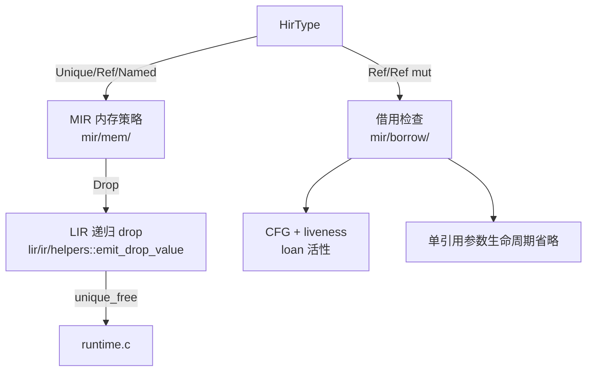
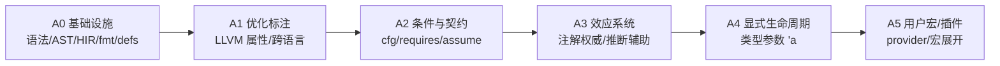
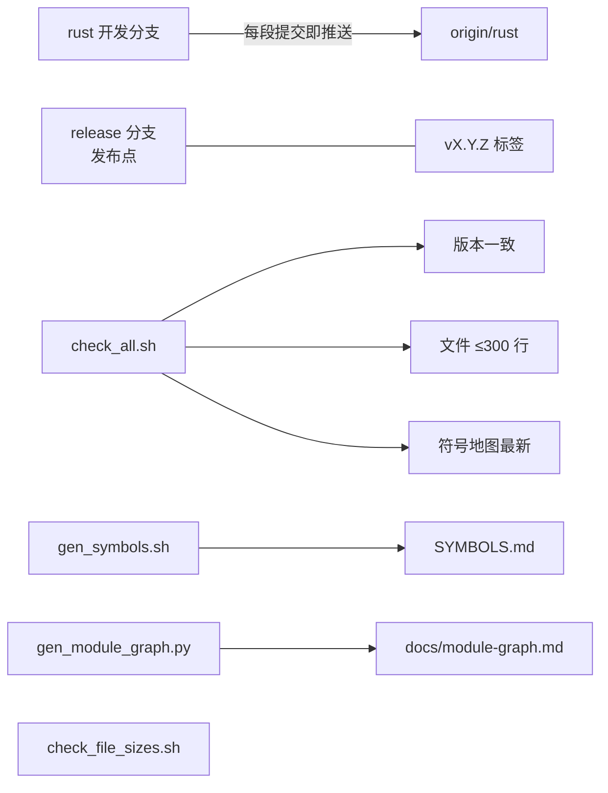

# Ayanami 知识图谱

> 用途：给人和 AI 一张"从概念到代码"的地图。先读这里，再按图索骥到文件；
> 精确定位符号仍用 `SYMBOLS.md` + `rg`。
>
> 维护规则：新增/移动子系统、语义或路线阶段时更新本文件；模块依赖图由脚本生成。

## 0. 文档地图

| 文档 | 内容 |
|---|---|
| `AGENTS.md` | AI 协作入口：命令、陷阱、约定、分支/版本规则 |
| `docs/knowledge-graph.md` | 本文件：概念与代码的映射 |
| `docs/module-graph.md` | 生成物：顶层模块依赖图（Mermaid） |
| `docs/bootstrap.md` | Compiler Bootstrap / self-hosting 路线（Phase 0.4） |
| `docs/annotations.md` | 标注系统（标注式编程）设计：A0–A5 路线 |
| `docs/generic-monomorphization.md` | 泛型结构体/枚举单态化（最小实现完成） |
| `docs/generic-inference.md` | 泛型推断统一化（Phase 4：P4a–P4d 已落地，统一 `unify`；P4e 接口见 const-eval） |
| `docs/lifetimes.md` | 注解式生命周期 `#[follow_with]` 设计（A4） |
| `docs/int-types.md` | 定宽整数类型（M1.1 核心完成）：集合/字面量适配/语义/实现位置 |
| `docs/c-interop.md` | C 互操作（`#[export]`）与 runtime 选择（`[runtime] path`/`AYANAMI_RUNTIME`，已实现） |
| `docs/typeclass.md` | typeclass/`Self`/关联类型设计（T1 已实现，其余评估关闭） |
| `docs/const-globals.md` | const / static / 编译期求值设计（M6.1 已实现） |
| `docs/const-eval.md` | 编译期求值与约束设计（P4e-1 接口边界；const fn / 类型级跟踪 #58） |
| `docs/optimization.md` | debug/release 双模式与语义优化（M-opt.1 已实现） |
| `docs/never-type.md` | never 类型 `!`（M1.9：发散表达式、`! → T`、`-> !` 发射） |
| `docs/pattern-matching.md` | 模式匹配增强（Phase 1.3：atb.1/2/3 已实现——字面量/`_`/`|`/guard、嵌套/解构/range、穷尽检查） |
| `docs/closures.md` | 闭包与捕获（M2 完成：`Fn(T)->U`/`FnOnce` 类型、按值/可变捕获、接口机制复用） |
| `docs/iterators.md` | 迭代器与 for（M3：for-in 协议 + 泛型接口虚调用；std 适配器已落地） |
| `docs/refs-storage.md` | 引用存储（M4：阶段 1 `Ptr[T]` 已落地；阶段 2 Arena 语言能力 + 示例完成，std 移植待做） |
| `docs/unsafe.md` | unsafe / FFI 安全边界（M5：P1/P2/P3 已落地；P4 extern 调用迁移待做） |
| `docs/runtime-safety.md` | 运行时安全行为权威清单（UB/panic；`tests/runtime_safety/` 覆盖） |
| `docs/future-directions.md` | 未来规划（探索，未实现）：统一引用关系模型 + 环境注入 |
| `README.md` | 语言与 CLI 用户手册 |
| `SYMBOLS.md` | 生成物：符号地图（路径:行号:签名） |

## 1. 编译管线（主图）


| 阶段 | 位置 | 关键入口 |
|---|---|---|
| CLI | `src/main.rs`、`src/cli/` | `cmd_*` |
| 词法 | `src/lexer/` | `Lexer::tokenize_all` |
| 语法 | `src/parser/` | `parse_source`、手写解析器 `parser/` |
| HIR | `src/hir/lower/` | `lower_program`、`to_mir.rs` |
| MIR | `src/mir/lower/` | `lower_program`、`mem/`、`borrow/` |
| LIR | `src/lir/lower/`、`src/lir/emit/` | `lower_program`、`emit_program` |
| 序列化 | `src/lir/serialize/` | `.lcl` payload |
| 管线编排 | `src/compiler/` | `CompilerPipeline`、`compile_file` |
| 驱动 | `src/driver/` | `ir_to_object`、`objects_to_exe` |
| 包 | `src/package/` | `Package`、`load_package` |
| 格式化 | `src/formatter/` | `format_file` |
| 驻留/位置/错误 | `src/intern/`、`src/span.rs`、`src/error.rs` | `Symbol`、`Span`、`Error` |

## 2. 所有权与借用子系统



| 概念 | 实现位置 | 说明 |
|---|---|---|
| 默认移动 / Copy | `hir/ty.rs::is_copy`、`helpers/wrap.rs` | 非 Copy 赋值/传参移动；use-after-move 报错 |
| 拥有堆值（内部 `HirType::Unique`） | `mir/mem/drop.rs`、`lir/ir/helpers.rs` | `[T]`/`[T; n]` 与拥有胖指针；递归释放；Copy 类型零开销（用户语法无 `unique`） |
| 数组元素布局 | `lir/ir/helpers.rs::elem_layout_size` | 分配大小按 LLVM 布局递归计算（结构体/枚举含对齐填充） |
| `ref` / `ref mut` | `mir/borrow/` | NLL：最后一次使用后失效；可存局部变量、可返回（单引用参数省略） |
| ref 自动解引用 | `hir/mod.rs::SDeref`、`hir/stmt.rs::DerefAssign` | 值上下文自动 load；`ref mut` 赋值穿透 store（LIR 复用 index-0 指针解引用） |
| 两阶段借用 | `mir/borrow/loans.rs` | 接收者位置可变借用先 reserved（`s.add(s.v)`） |
| 接口胖指针 | `hir/ty.rs::FatPtr`、`lir/ir/nodes_b.rs::MakeFatPtr` | `ref Shape` 借用 / `Shape` 拥有 |
| 赋值/字段覆盖旧值 drop | `mir/lower/assign.rs` | RHS 先求值到临时量，旧值 drop 后置；仅确有 drop 时建临时量 |
| 借用临时量提升 | `mir/lower/temps.rs` | `f(ref "x")` 等拥有临时量提升为局部变量，语句后 drop |
| match/if 表达式结果 | `hir/item.rs::HirLocal::result`、`match_lower.rs`/`if_expr.rs` | 条件赋值结果变量不参与覆盖/块末 drop，链后移出到最终临时量 |
| 实参移动门控 | `helpers/wrap.rs::type_needs_drop`、`expr_call.rs` | 拥有堆数据的命名类型按值传参移动；extern 借用、POD 复制 |
| M4 拥有指针 | `helpers/types.rs`（`Ptr[T]`→`Unique`）、`expr_call.rs`（`Ptr::new`）、`expr_method.rs`（`get`/`get_mut`/自动解引用）、`match_setup.rs`+`match_pattern.rs`（match 就地匹配/载荷绑定）、`place.rs`（字段地址自动解引用） | `Ptr[T]` 堆拥有指针：字段/数组存储、递归 drop、`ref Ptr[T]` 借用、match 互操作（`Some(p)` 载荷、Ptr 目标、`ref a.next`）；设计见 docs/refs-storage.md |
| 类型化 drop 函数 | `lir/lower/mod.rs`（按需合成 `__drop_<n>`）、`lir/ir/helpers_drop.rs` | Named 释放统一走弱链接函数，递归/互递归类型终止 |
| 泛型多约束 | `parser/parser/generic_params.rs`、`hir/lower/body/generic_types.rs` | `[T: A + B]`（每参数 `Vec<Symbol>` 约束）；方法/操作符按任一 bound 检查，调用点合并检查全部 |
| 泛型推断（Phase 4） | `helpers/unify.rs`（统一结构匹配/绑定）、`body/generic_specialize.rs`（调用点特化/冲突诊断/失败回滚）、`helpers/convert.rs`（AST 形参→HirType→unify 适配器）、`body/iface_args.rs`（约束反推 `infer_from_iface_constraints`）、`body/expr_struct.rs`（结构体字面量实参推断） | P4a/P4b/P4c/P4d 已落地（嵌套匹配唯一实现 = unify）；P4e 接口预留见 docs/const-eval.md |
| 编译期求值/约束（P4e） | `body/const_eval.rs`（const 项求值）、解析期 `[T; N]` 尺寸、`body/generic_types.rs`/`generic_check.rs`（泛型约束）、`hir/effects/*`（纯度） | 接口边界与阶段见 docs/const-eval.md；P4e-2 `const fn`、P4e-3 const generics 待做 |
| 局部移出清零 | `lir/ir/nodes_f.rs::SLirLocalTake` | 局部变量移动后清零，循环回边重复移动不双重释放 |
| 导入所有权补全 | `hir/lower/body/collect_import.rs` | 符号串路径 `[T]` → `unique [T]`；LIR 精确类型优先 |
| 接口箱递归 drop | `lir/lower/mod.rs`（合成 vtable[0]）+ `lir/ir/helpers_drop.rs` | 拥有胖指针释放前调用具体类型 drop glue（弱链接、跨模块去重） |
| 数组元素递归 drop | `lir/ir/helpers_drop.rs` | 静态计数数组逐元素释放；动态 `[T]` 按容量兄弟字段（`capability`/`cap`，回退 `len`）覆盖全槽（pop/remove 越界原值也释放） |
| 元素读取 clone | `lir/ir/helpers_clone.rs` | 非 Copy 元素读取深拷贝（非破坏性）：集合保留原值、调用方拥有副本，配合元素 drop 无泄漏/双重释放 |
| 动态数组计数释放 | `mir/lower/assign_field.rs`、`lir/ir/helpers_drop.rs::SLirDropArray` | 字段覆盖旧动态数组时从兄弟字段取计数逐元素释放（expand 旧数据） |
| 条件临时量 | `mir/lower/control.rs`、`lir/lower/mir_stmts_loops.rs` | while/elif 条件的借用临时量在循环头/分支链内每轮求值后 drop（pre_cond/post_cond） |
| noreturn 分支发散 | `mir/lower/checks.rs::block_diverges` | panic 等 `!` 调用分支的移动不合并——隐藏文件参数正常路径正常释放 |
| void 返回值（#168） | `hir/lower/body/stmt_lower.rs`（`Stmt::Return` 类型一致性）、`mir/lower/ctx.rs::lower_return` | `return <void 调用>` 求值副作用后无值返回（不建临时量 ⇒ 无 `alloca void`）；`-> int` 里返回 void 值 / void 函数里返回值均报错（`!` 发散表达式除外） |
| 内存运行时 | `src/runtime.c` | `unique_alloc/free` + 存活计数（无 RC/GC） |
| M5 unsafe 边界 | `parser/parser/stmt.rs`（`unsafe {}` / `unsafe fn`）、`hir/lower/body/stmt_lower.rs`（`unsafe_depth`）、`expr_call.rs`/`expr_misc.rs`/`ctx.rs`（asm、unsafe 调用、static mut 门控） | P1：unsafe 语法 + asm/unsafe-call/`static mut`（读写与 ref mut）门控；设计见 docs/unsafe.md |
| M4 Arena 句柄 | `mir/borrow/collect.rs`（loan 回溯含索引；origin 取根变量）、`parser/parser/array_expr.rs`（`[T; n]` 复合元素类型）、`lir/lower/place.rs`（元素地址） | 阶段 2：`Arena[T]`（`[Ptr[T]]` 存储）+ `Idx` 句柄（`ref` 索引取借用）；示例 `example/test_arena.aya`（双向链表/图 DFS 无泄漏） |
| M5 裸指针 `*T` | `parser/parser/types.rs`（`*T` 类型）、`unary.rs`（`*p`）、`expr_cast.rs`（int/ref/Ptr ↔ `*T`）、`expr_method.rs`（`as_ptr`）、`nodes_conv.rs`（inttoptr/ptrtoint/bitcast） | P2：Copy 标量（LLVM `ptr`）、解引用读写/字段、指针↔int、`ref [T]` 取缓冲区；全部需 unsafe |
| M5 reinterpret / 指针算术 / volatile | `expr_call.rs`（`bits::reinterpret` 拦截 + 尺寸检查）、`expr_method.rs`（`offset`/`read_volatile`/`write_volatile`）、`nodes_volatile.rs`（LLVM volatile 发射）、`mir_ptr_ops.rs` | P3a：同尺寸位重解释 + 元素步长指针算术 + volatile 读写；全部需 unsafe |
| M5 数组越界检查 | `helpers/bounds.rs`（`insert_bounds_check`/`ensure_bounds_helper`）、`expr_access.rs`（`arr[i]` 插检查）、`expr_method_arrays.rs`（`get_unchecked`） | P3b（Rust 方式）：`[T; n]` 默认检查（panic 101）；`get_unchecked` 需 unsafe；动态 `[T]` 保持原语 |
| M5 union | `parser/parser/decl.rs`（`union U { ... }`）、`collect_ns.rs`（`__union` 标记 + 字段 drop-free 检查）、`ctx_fields.rs`（字段索引恒 0）、`nodes_b/c.rs`（共享存储 load/store）、`helpers.rs`/`functions.rs`（max 布局/单槽类型） | P3b：字段共享存储；读取需 unsafe，写入/初始化无需；限无 drop 字段；裸指针 `==`/`!=` 地址比较 |

## 3. 标注系统路线（设计见 `docs/annotations.md`）



| 实体 | 位置 | 状态 |
|---|---|---|
| `#[...]` 语法/AST | `parser/parser/core.rs`、`parser/ast` | A0 已完成 |
| 属性注册表/校验 | `hir/attrs` | A0 已完成 |
| 标注携带（MIR/LIR/包） | `mir/ir.rs`、`lir/ir/nodes_d.rs`（`LirAttr`/`ExternDecl`）、`lir/serialize` | A1 已完成 |
| LLVM 属性映射 | `lir/emit/functions.rs`（`llvm_attr_suffix`/`llvm_param_attrs`）、`lir/emit/mod.rs` | A1 函数级+形参级已完成 |
| extern 真实签名 | `lir/lower/mod.rs`（`extern_decls`） | A1 已完成 |
| cfg 条件裁剪 | `hir/cfg.rs`、`package/symbols.rs` | A2b 已完成（A2f 起含语句级） |
| 契约标注（assume/requires/ensures/invariant） | `hir/contracts.rs`、`hir/lower/body/ensure.rs`、`HirStmt::{Assume,Contract}` → `SMir*` → `SLir*`、`runtime.c` | A2c/A2d/A2e/A2f 已完成 |
| 标注 provider/宏 | `parser`（AttrPath）、`hir/attrs*.rs`（Imports/注解校验）、`.lcl` 宏/pass/依赖表、`compiler/macro_expand/{mod,plugin,pass_plugin}.rs`（.so + dlopen）、`compiler/build/passes.rs` + `std/mir.aya`（MIR pass，A5d-2） | A5a–A5d-2 已完成（MVP） |
| 效应系统 | `hir/effects/{mod,infer,diag,scan}.rs`（注册表/推断/诊断）、`LirEffects` 自动属性、`.lcl` 效应 tokens（声明+推断+承诺） | A3 重构完成（Stage 1–3） |
| 错误传播 `?` | `hir/lower/body/expr_ops1.rs`（pending 语句内联 + 早退）、`ctx.{variant_payload_type,instantiate_*}` | A3d 已完成（含泛型 Result 最小单态化） |
| 生命周期 `#[follow_with]` | 计划：字段属性文法 + `mir/borrow/` 来源标记 | A4 设计（docs/lifetimes.md） |

## 4. 工具与流程



| 脚本 | 作用 |
|---|---|
| `scripts/check_all.sh` | 版本 + 行数 + 符号地图 + 零告警 + 语言回归 + IR 快照 |
| `scripts/gen_symbols.sh` | 生成/校验 `SYMBOLS.md` |
| `scripts/gen_module_graph.py` | 生成本文件同目录的 `module-graph.md` |
| `scripts/check_version.sh` | Cargo/插件/std/标签版本一致 |
| `scripts/check_file_sizes.sh` | 单文件 ≤300 行 |

## 5. 常用查询

```bash
rg "关键词" SYMBOLS.md          # 符号 → 文件:行号:签名
rg "use crate::mir" src         # 反向依赖
python3 scripts/gen_module_graph.py   # 刷新模块依赖图
rg -n "TODO|FIXME" src docs     # 待办
```

## 6. C 互操作、runtime 与 typeclass（#84）

| 概念 | 实现/设计位置 | 说明 |
|---|---|---|
| `#[export]` / `extern "C"` 定义 | `hir/attrs.rs`、`hir/lower/body/lower_items.rs`、`mir/lower/functions.rs`、`lir/lower/names.rs` | 导出 C 符号（原始名）；空体 = 外部声明 |
| 自定义 runtime | `package/config.rs`、`driver/runtime.rs`、`driver/mod.rs` | `[runtime] path` / `AYANAMI_RUNTIME`；.c/.a/.o 替代内置 runtime.c |
| 回归夹具 | `tests/c_export/`、`tests/runtime_custom/` | C harness 互操作 + runtime 选择三路径 |
| typeclass/`Self` | `docs/typeclass.md`、`hir/lower/body/iface_match.rs`、`parser/self_type.rs` | T1 已实现（签名 Self 消解 + 对象安全诊断）；T2–T5 评估关闭；参数化接口约束可用（违例检查已修复） |
| 闭包/捕获（M2） | `docs/closures.md`、`parser/parser/{types,decl}.rs`（`Fn` 解析 / 安全代码禁裸 `fn`）、`hir/ty.rs`（`HirType::Closure(ps,ret,owns)`）、`hir/lower/helpers/closure{,_lower,_static}.rs`（捕获分析 / 拥有 env / 静态 trampoline）、`hir/lower/body/expr_misc.rs`（`lower_lambda`） | 统一：安全代码只用 `Fn(T)->U`；命名函数/非捕获 lambda=静态闭包（Copy、零分配），捕获=拥有闭包；裸 `fn` 仅 extern C |

## 7. 关系索引（压缩版）

- 管线：`lexer → parser → hir → mir → lir → emit → opt -O2(可选) → llc → gcc`
- 所有权：`HirType::Unique/Ref` —实现于→ `mir/mem` —检查于→ `mir/borrow` —发射于→ `lir/ir` —运行于→ `runtime.c`
- 语法：手写递归下降 `src/parser/parser/` —AST→ `src/parser/ast`（唯一解析路径）
- 包：`hir` —序列化→ `lir/serialize` —封装→ `package` —导入→ `compiler/import`（解析顺序：本地精确 → `.aya` → 配置别名 → std 目录 `.aya`/`.lcl`；依赖闭包缺失 → `resolve_package_deps` 清晰诊断）
- 模块私有（nsr 可见性层）：非 pub 自由函数 —导出→ `.lcl` `private` 标记（`package/symbols.rs`）—导入→ 不注册进导入方符号表（`collect_import.rs`；extern `"C"`/`#[export]` 豁免）；private static —多模块→ `internal`（`lir/emit/consts.rs`）；来源作用域解析/模块限定名属 M6 后续
- 工具链：`check_all` ⊃ `check_version` + `check_file_sizes` + `gen_symbols --check` + `check_warnings` + `regression` + `ir_snapshot`
- 标注：`#[...]` —校验→ `hir/attrs` —携带→ MIR/LIR(`LirAttr`/`ExternDecl`) —映射→ LLVM 属性（A1 函数级）—计划→ 效应（A3）/生命周期（A4）
- 泛型/内联：定义以**源码**随 `.lcl` 导出（`source=`）→ 导入方本地重新实例化 → 发射 `linkonce_odr` 弱链接去重（#100 设计）
- 定宽整数：`i8..i128/u8..u128/isize/usize` —解析→ `fixed_width_int` —HIR→→ `HirType::IntN` —字面量适配→ `as_int_literal`/`retype_int_literal` —发射→ `iN` 算术/`icmp`（按 signed）
- C 导出：`#[export]`/`extern "C"` 定义 —校验→ `hir/attrs` —HIR→ `extern_c` —MIR/LIR→ 保留函数体 —发射→ 原始符号名（默认可见）
- runtime：`AYANAMI_RUNTIME`/`[runtime] path` —解析→ `driver/runtime.rs` —链接→ `objects_to_exe_with_runtime`（.c/.a/.o 替代内置 runtime.c）
- const：`const NAME = expr` —解析→ `Stmt::ConstDecl` —求值→ `hir/lower/body/const_eval.rs` —替换→ `expr_lower.rs`（Ident → `SConst`）—用途→ 数组大小（`ArraySized`）
- compile_time：`#[compile_time] fn f(...)` —预收集→ `collect_fns`（`ctx.const_fns`）—常量上下文→ 解释执行（`const_fn.rs` + `const_eval.rs`）—运行期→ 普通函数调用
- 优化模式：`--release` —关溢出/契约检查→ 回绕/assume —推断属性→ `noalias`（`ref mut`/owned）/`nounwind` —内部化→ 非导出函数/全局/vtable wrapper `internal`（LIR4 `is_pub`）—中端→ `opt -O3` + `llc -O3`；debug 跳过 opt
- static：`static [mut] NAME = expr` —求值→ `const_eval.rs` —HIR→ `SGlobal`（地址）—MIR→ `SMirGlobal` —LIR→ `SLirGlobalAddr` + `LirProgram.globals` —发射→ `@name = global`
- 效应：`#[pure]/#[no_error]/#[throws]` —推断→ `hir/effects/infer.rs`（调用图不动点）—发射→ `nounwind`/`memory(none|read)`；合成位置串（`SFileArg`）与标记不计入（#117）
- 位运算：`& | ^ << >> ~` —文法→ operator（prec 6–9 / 前缀）—HIR→ `lower_binary`/`lower_unary` —发射→ `and/or/xor/shl/ashr/lshr` —折叠→ `example/constfold_lib.aya`
- 显式转换：`expr as T` —解析→ `parse_cast` / 运算符表 prec:12 —HIR→ `lower_cast`/`SCast` —发射→ `sext/zext/trunc/sitofp/uitofp/fptosi.sat/fptoui.sat`
- 泛型推断：约束收集 → `helpers/unify.rs`（统一结构匹配/泛型参数绑定）—应用→ `substitute_hir_type` —特化→ `generic_specialize.rs`（冲突诊断 P4d/失败回滚）；见 docs/generic-inference.md
- 闭包：`Fn(T)->U` / lambda —解析→ `parse_type`（`Fn(` 特判；安全代码禁裸 `fn`）/ `parse_lambda`（Block 尾表达式）—捕获分析→ `helpers/closure.rs` —降级→ 拥有：`closure_lower.rs`（`__ClosureEnv_N` + `__lambda_N(env,…)` + `__closure_drop_N`）；静态：`closure_static.rs`（每签名 trampoline + noop drop）—调用→ `SVCall`（vtable slot 1）—释放→ `emit_drop_value(Closure)` 经 vtable slot 0

## 8. 未来方向（规划记录，未实现）

设计探索记录见 [`docs/future-directions.md`](future-directions.md)（示例语法未锁定）：

- **统一引用关系模型**：`Ref<T, U>` —语义→ 指针/ID/句柄/自定义解析统一为编译器可分析的引用关系（目标：生命周期、失效、别名、序列化信息进入 IR）
- **环境注入**：`#[env::alloc]` —声明→ 环境需求（编译期可分析的隐式泛型约束）—传播→ 调用链自动继承、内层显式覆盖 —首个应用→ 自定义分配器
- 共享基础设施：环境传播、约束检查、IR 分析；不合并语义边界（引用关系 ≠ 环境依赖 ≠ 所有权 ≠ effect）
